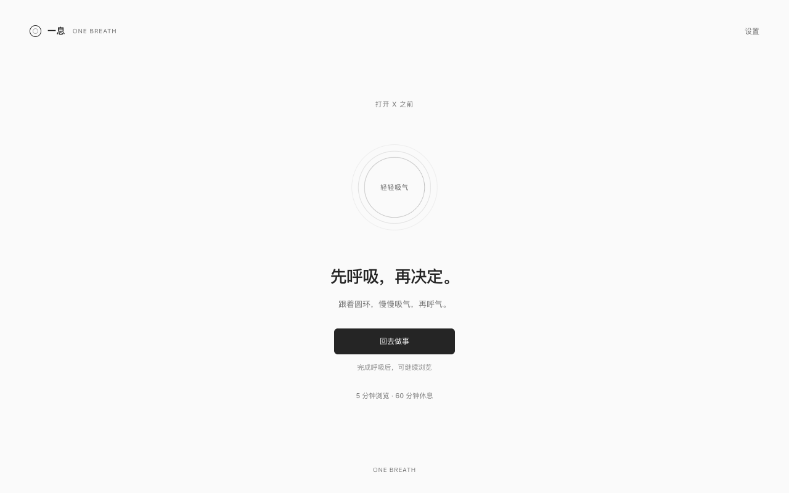

# 一息 · One Breath

**MIT 开源 · Chrome 120+ · 无后端**



一个本地运行的 Chrome 扩展：打开推特前先停一息，浏览结束后再开始冷却。无需账号、无需构建、无运行时依赖，不上传浏览记录。

## 安装（Chrome 120 或更高版本）

1. 在你日常刷推特的 Chrome 身份中打开 `chrome://extensions`。
2. 打开右上角的「开发者模式」。
3. 点击「加载已解压的扩展程序」。
4. 选择此项目中的 **extension** 文件夹：
   即解压或克隆仓库后包含 `manifest.json` 的目录。
5. 在工具栏的拼图菜单中固定「一息」。点击图标进入偏好设置。

安装后会拦截该 Chrome 身份内现有的推特页面。默认单次浏览 5 分钟，结束后冷却 60 分钟；请先调整到适合自己的值。更新源码后，在扩展管理页点「重新加载」，再刷新已有推特页面。

## 会话规则

- `x.com`、`twitter.com` 及其子域名共用一次会话，包括同一 Chrome 身份的所有窗口。
- 开始前选择自然呼吸（12 秒）或眼睛休息（20 秒）。完成后可以「回去做事」，不消耗浏览机会。
- 只有点击「开始浏览」才启动会话。新标签页、刷新、站内跳转、切换域名均不增加时间。
- 浏览按连续墙钟时间计算，切到其他应用、后台停留和电脑休眠都不暂停。
- 到时自动替换所有推特页面，停止原页音视频，并开始冷却。
- 页面右下角和插件弹窗都有「结束浏览」按钮。主动结束、关闭或离开最后一个推特页面，会立即开始冷却。
- 关闭其中一页、但仍有其他推特页面时，不结束会话。在会话中按后退回到提醒页，仍属于这次会话，可继续剩余时间或关闭。
- 冷却结束不自动打开推特，需要重新完成提醒并主动开始。
- 冷却期间可点击「临时访问 · 3 分钟」，直接访问完整的推特。多个标签页共享临时额度，刷新或重复点击不续时。
- 临时访问不改变原冷却截止时间；到期、主动结束或关闭最后一个推特标签页后，回到原冷却。如果原冷却已经结束，则回到可开始状态。临时访问不限制使用次数，每次均需手动开启。
- 偏好修改仅影响下一次新会话，不改变当前浏览和冷却的截止时间。
- 设置范围：浏览 1–120 分钟，冷却 1–1440 分钟。

例如：10:00 开始，最多浏览 5 分钟，冷却 60 分钟。自然结束则 11:05 可再开始；10:02 主动结束则 11:02 可再开始。

## 恢复与保护范围

状态保存到 `chrome.storage.local`，使用绝对截止时间计算。浏览器重启、扩展后台服务休眠都不会发放新额度。休眠期间已经耗尽的会话，仍按原截止时间起算冷却。

Chrome 正常运行时依靠页面计时、浏览器 alarm、页面切回检查和网络重定向共同执行。操作系统冻结进程时无法运行计时回调；恢复后会检查绝对截止时间。浏览器崩溃或强制结束进程时，无法可靠得知最后一个标签页的关闭时刻，因此保留原会话截止时间，按其起算冷却，不重置额度。

这是自我约束工具：不会阻止你卸载或禁用扩展。不跨 Chrome 身份、其他浏览器和设备同步；无痕模式不启用。不针对修改系统时钟或开发者工具篡改状态做防作弊处理。

## 权限和隐私

- `storage`：本地设置、会话截止时间及参与会话的标签页 ID。呼吸校验只保存在当前浏览器会话。
- `alarms`：后台到期检查。
- `tabs`：判断最后一个推特标签页是否关闭，以及将已有推特页面转为提醒页。不会保存其他网站 URL。
- `declarativeNetRequest` 和仅限推特域名的主机权限：拦截新访问和执行推特页面的到时检查。

无服务器、遥测、远程字体、Cookie 读取或外部脚本。

## 开发与验证

无需安装依赖即可运行状态机测试：

```sh
npm test
```

浏览器回归脚本使用 Playwright 的独立临时身份，加载真实 MV3 扩展，推特响应由模拟 HTML 替代，不使用个人登录状态：

```sh
npm ci
npx playwright install chromium
npm run test:browser
```

浏览器脚本需要 Playwright Chromium 和 Node.js 22 或更新版本。也可通过 `PLAYWRIGHT_PATH` 指定已安装的 Playwright 模块路径。生命周期测试包含一次真实 60 秒会话。

截图保存在 `output/playwright/`。

## 文件结构

- `extension/model.js`：纯会话状态机和输入校验。
- `extension/background.js`：串行处理会话操作、动态重定向规则和截止时间恢复。
- `extension/guard.js`：已打开页面的到时拦截、切回检查和结束浏览按钮。
- `extension/gate.*`：呼吸、眼睛休息和冷却界面。
- `extension/settings.*`、`extension/popup.*`：偏好设置和状态入口。

## 参考

- Chrome 网络重定向 API：https://developer.chrome.com/docs/extensions/reference/api/declarativeNetRequest
- Chrome 定时器及延迟约束：https://developer.chrome.com/docs/extensions/reference/api/alarms
- one sec 官网：https://one-sec.app/

此项目借鉴「先停顿再决定」的交互思路，界面和代码为独立实现，与 one sec 无关联。

## 开源与上架

使用 [MIT 许可证](LICENSE)，可使用、修改和再分发。隐私说明见 [PRIVACY.md](PRIVACY.md)。问题反馈请提交 Issue；贡献代码请提交 Pull Request，并附验证步骤。

Chrome Web Store 尚未上架。[商店提交资料](docs/STORE_LISTING.md)已准备。运行 `npm run package` 生成商店上传包，`manifest.json` 位于 ZIP 根目录，不包含测试、截图或浏览器缓存。
